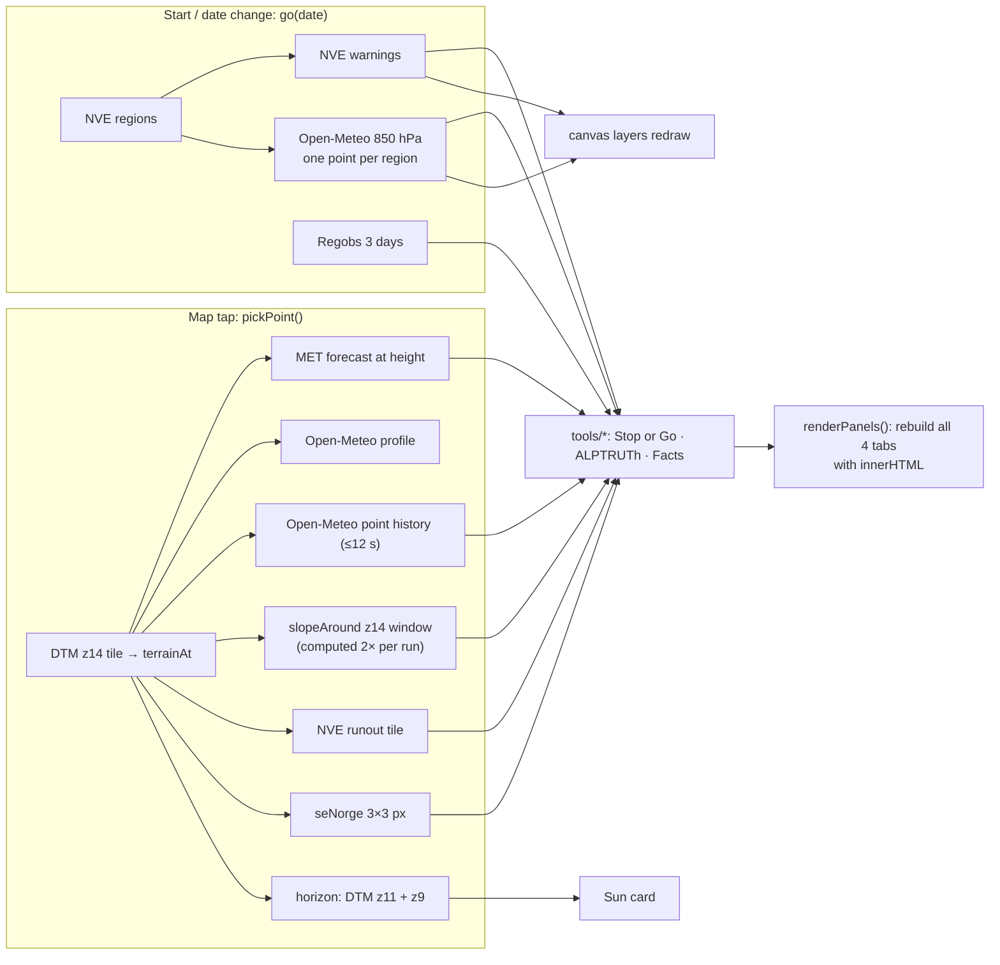

# tourit (Skredterreng Norge): code review

**Date:** 2026-11-20 · **Commit:** `e455f30` · **Scope:** all of `src/` (78 modules, ~9 850 lines of TS), `test/` (8 files, 66 tests), `public/sw.js`, `vite.config.ts`, `index.html`, CI.

The review covers four areas:

1. Security
2. Maintainability
3. The data and calculations behind the overlays, tools and facts
4. Dataflow and usability

Each finding has a severity (**High** / **Medium** / **Low**) and a file reference. A prioritised to-do list is at the end.

---

## 0. Summary

The app is a well-built static PWA. It reads open data and has no backend, no secrets and no user accounts. The pure logic in `src/domain/` is cleanly separated and documented. Almost every rule says where it comes from, and the code marks which cut-offs are its own. The README is unusually honest about the app's limits. The usual web risks (XSS, injected URLs) are handled consistently.

The biggest risks are not classic security problems. They are about **safety integrity**: a planning aid can show a reassuring answer when data is missing or out of date.

| Area | Grade | Main point |
| --- | --- | --- |
| Security (classic web) | **Good** | `esc()` and `safeUrl()` are used on every HTML sink I found. There is a strict CSP and no secrets. The remaining risk is the shared `github.io` origin and what it means for the integrity of stored warnings. |
| Safety integrity | **Needs work** | When data is missing, Stop or Go falls back to the *optimistic* answer and doesn't say so. A slow network can leave stored data on screen for the rest of the session. |
| Calculations | **Good, with caveats** | The standard formulas (Horn, Stull wet-bulb, sun position, curvature/refraction, Munter, SLF critical new snow) are implemented correctly. Several cut-offs are the app's own (as the code says). The riskiest mapping, the NVE height band, has no tests. |
| Maintainability | **Good, with caveats** | The layering is clear and the domain is pure and tested. But CI doesn't run the tests, half the domain modules have no tests, there is some duplication, and `routePage.ts`/`main.ts` are getting large. |
| Usability | **Good, but dense** | The texts are clear and every number has a "why". There are many verdicts that can disagree with each other, and some re-render glitches. |

---

## 1. Security

### 1.1 What is already good

- **Escaping is consistent.** All 36 `innerHTML` sinks build their HTML from constants, numbers or `esc()`'d text. Regobs data written by users (`ui/obsHtml.ts`), NVE warning text (`ui/detail.ts`), place names (`ui/search.ts`) and route names (`ui/routePage.ts`) are all escaped. Every attribute uses double quotes, which is what `esc()` (`src/util.ts:8`) covers. It does not escape `'`, so that convention has to hold.
- **URLs from API data** go through `safeUrl()`, which allows `https:` only (`src/util.ts:15`). The steepness legend's base64 images are checked against a strict pattern before they go into a `data:` URI (`layers/steepness.ts:39`).
- **CSP** (`vite.config.ts:41`): `script-src 'self' 'wasm-unsafe-eval'`, `object-src 'none'`, `form-action 'none'`, `base-uri 'self'`, and `connect-src`/`img-src` limited to the known hosts. `style-src 'unsafe-inline'` is needed (Leaflet) and is low risk.
- **Input parsing is defensive:**
  - The URL hash is checked with regexes and `validPos` (`viewState.ts:49–86`).
  - GPX uses a strict number regex and caps on point counts (`route/gpx.ts:12–16`).
  - Values read from localStorage are checked before use: ALPTRUTh ticks `clean()` (`tools/ticks.ts:26`), routes `isRoute` (`route/store.ts:22`), and settings only accept values that exist in the `<select>`.
- **No secrets and no API keys.** CI has the minimum permissions (`contents: read`, `pages: write`, `id-token: write`). Dependabot is configured.

### 1.2 Findings

| # | Sev. | Finding |
| --- | --- | --- |
| S1 | **Medium** | **The shared origin is a risk to data integrity, not only to privacy.** Every Pages site on `knuteriks.github.io` shares Cache Storage, localStorage and service-worker scope. The README covers the privacy side. The more serious side for this app is that a compromised or careless sibling repo can write to `tourit-data-v1` (`offline/dataCache.ts:14`) or `tourit-tiles-v1`. For example, it could put a level-1 warning where the real one is level 4, and the app would show it as "lagret". **Fix:** use a custom domain (one line in Pages settings plus a `CNAME`). This is the cheapest high-value change in this review. |
| S2 | Low | **A meta CSP can't set `frame-ancestors`**, so anyone can frame the app (clickjacking). The impact is small because there are no sensitive actions. A custom domain behind Cloudflare/Netlify would allow real headers (`frame-ancestors 'none'`, `X-Content-Type-Options`). |
| S3 | Low | **GitHub Actions are pinned to major tags** (`actions/checkout@v7`, …) rather than commit SHAs. Pinning to SHAs (Dependabot keeps them current) closes the "tag moved" supply-chain gap. |
| S4 | Low | **Location goes to third parties.** When "Min posisjon" is on and nothing is tapped, the live position (rounded to ~100 m–1 km) goes to `api.met.no`, `api.open-meteo.com` and the elevation/tile hosts (`ui/tools.ts:68–73`, `tools/history.ts`). The About dialog should say which services receive positions. The contact link also fills in `navigator.userAgent` (`ui/about.ts:20`); this is visible before sending, so it's fine, but a privacy note should mention it. |
| S5 | Low | **Unvalidated values can crash the UI.** `DangerLevel` is parsed but never clamped to 0–5 (`api/nve.ts:57`). A 6 from the API would throw at `DNAME[max].toLowerCase()` (`main.ts:127`) and draw an `undefined` colour. `DATE_RE` (`viewState.ts:46`) accepts `2026-13-45`, which makes `isoDate()` throw `RangeError` in `api/regobs.ts:23`. Clamp the level, and check the date with `!isNaN(Date.parse(d))`. |
| S6 | Info | GPX goes through `DOMParser('application/xml')`. Browsers don't resolve external entities and they limit entity expansion, so XXE and "billion laughs" are not a practical risk. |

---

## 2. Maintainability

### 2.1 What is already good

- **Clear layers:**
  - `api/`: fetch and parse
  - `domain/`: pure rules, tested
  - `tools/`: put the data together for a tool
  - `terrain/` and `layers/`: rasters
  - `ui/`: HTML
  - `main.ts`: the only orchestrator

  Most domain modules import only types, so `node --test` loads them with no bundler.
- **Comments explain *why*, cite the source, and mark the app's own choices.** This is rare and valuable for a safety tool.
- Strict TypeScript (`strict`, `noUnused*`, `noFallthroughCasesInSwitch`) passes cleanly, and all 66 tests pass.
- Very few dependencies (Leaflet, lerc, MapLibre loaded on demand, mgrs, fonts).

### 2.2 Findings

| # | Sev. | Finding |
| --- | --- | --- |
| M1 | **Medium** | **CI doesn't run the tests.** `deploy.yml` runs `npm ci && npm run build`, and the build only type-checks. A failing domain test can go live. Add `npm test` before the build. |
| M2 | **Medium** | **The tests aren't type-checked, and the documented Node version can't run them.** `tsconfig.json` has `"include": ["src"]`, so `test/` is never checked. `npm test` runs `.ts` files directly, which needs Node's built-in type stripping (Node ≥ 22.18 / 23.6). The README says "Node 20.19+", and on Node 20 `npm test` fails. Either add `test` to a `tsconfig.test.json` or to `include`, and raise the documented minimum. |
| M3 | **Medium** | **Gaps in test coverage, in the riskiest places.** 8 of 15 domain modules have tests. These have none: |
| | | • `domain/problems.ts` `heightTest`: the README calls this NVE pictogram reading the mapping to fix if hits look wrong. It drives the terrain layer, Stop or Go's core zone, Munter and SLABS DCE. |
| | | • `domain/wind.ts` (lee slopes, snow-surface state machine) |
| | | • `domain/weather.ts` (wet-bulb, `snowLine`, `cloudLayers`, `summarize`) |
| | | • `domain/sun.ts` (sunrise, polar night and midnight sun) |
| | | • `domain/geo.ts`, `domain/mgrs.ts` |
| | | • the parsers `fromMet`, `fromOpenMeteo` and `parseGpx`, plus `parseHash` and `withStored` |
| | | A handful of golden tests with real API responses saved as fixtures would also catch upstream format changes. |
| M4 | Low | **The same rule is coded in several places.** These copies can drift apart: |
| | | • `cmPerMm` (`domain/precip.ts:64`) and `snowRatio` (`domain/weather.ts:128`) are the same function twice. |
| | | • Rain/snow is decided by wet-bulb in `snowFraction` but by an 850 hPa air-temperature ramp in `snowShare` (`domain/wind.ts:121`). This is deliberate, but it's easy to tune one and forget the other. |
| | | • The day window 08–16 is written in `tools/alptruth.ts:25` and again inline in `tools/infos.ts:44`. The Weather tab uses 06–18 (`ui/weather.ts:12`). |
| | | • `num()` number formatting exists 4 times; `dirName` twice, and the `ui/point.ts:56` copy doesn't normalise negative degrees. |
| | | • `CIRC` is defined 3 times, `HOUR` 8 times, and the "Map + evict the first key" cache is copied 5+ times. A small `boundedCache()` helper and a `units.ts` would remove most of this. |
| M5 | Low | **Two big modules.** `ui/routePage.ts` (832 lines) mixes map layers, edit state, three background jobs, SVG rendering and event wiring. `main.ts` (616 lines) holds both startup and runtime orchestration. Possible splits: `route/editor.ts` (state and undo), `route/jobs.ts` (profile, runout and risk jobs with one abort controller), `ui/routeView.ts` (rendering). |
| M6 | Low | **Values that must match are kept in step by hand.** |
| | | • `TILE_CACHE` in `public/sw.js:19` and `OFFLINE_CACHE` in `config.ts:92` must be equal. The comment in `config.ts` calls it `CACHE`, which is wrong. `swPrecache()` already writes values into `sw.js`, so it could write this name too. |
| | | • Saved-area tile URLs must match the layers' URLs byte for byte (`offline/tiles.ts:8`). A test comparing `areaTiles()` with `demUrl()` and the layers' oversampling would guard this. |
| M7 | Low | **Two modules break the "domain is pure" rule.** `domain/wind.ts:27` imports `isoDate` from `util.ts`, which also holds DOM helpers, and `domain/observations.ts` imports Leaflet. Both work today, but this weakens the rule that makes the domain testable. Move `isoDate` to a pure `dates.ts`. |
| M8 | Low | **Stale docs.** |
| | | • The README's Dependabot step tells you to move `docs/dependabot.yml`, but the file is already in `.github/`. |
| | | • The `StopOrGoInput.inRunout` doc (`domain/stopOrGo.ts:41`) says it includes "steep terrain on that map", but the caller leaves `steep` out (`tools/stopOrGo.ts:50`). |
| | | • `rf1` has two JSDoc blocks on top of each other (`domain/risk.ts:127–133`). |
| | | • The infos are called "Infos" in code and README but "Facts" in the UI. Pick one. |

---

## 3. Data and calculations

### 3.1 Where the data comes from

| Source | Used for | Resolution | Cached as |
| --- | --- | --- | --- |
| NVE Varsom API v6.3.2 | regions, warnings, problems | per region (tens of km) | Cache Storage, 8 dates |
| NVE Bratthet (with runout) tiles | steepness layer, runout zone at a point and along a route | z14 pixels (~3–6 m) | tiles (saved areas) |
| Kartverket DTM (`hoydedata.no` exportImage, LERC F32) | slope, aspect, elevation, 20 × 20 m window, horizon | z14 ≈ 4.5 m @62° N | memory (500 tiles), saved areas |
| seNorge WMS | snow layer, snow or bare ground at a point | 1 km | none |
| Regobs v5 `/Search` | observations, danger signs, ECTs | point reports, but used **per region** | Cache Storage, 4 dates |
| MET Locationforecast 2.0 | point forecast at DEM height | ~2.5 km model, 1 h then 6 h steps | memory until `Expires`, 6 stored |
| Open-Meteo ICON | air profile, region 850 hPa wind, point history at height | 7 km (ICON-EU) | memory 1 h, stored |
| Sun and horizon | daylight, sun on slope | DTM z11 to 4 km, z9 to 20 km | memory, 30 points |

### 3.2 Each calculation checked

✔ = matches the cited source / standard · ⚠ = the app's own choice or approximation (marked in code) · ✖ = a problem I found

| Calculation | Where | Check | Notes |
| --- | --- | --- | --- |
| Slope (Horn 3×3) and aspect | `terrain/dem.ts:75` | ✔ | Weights are right. Cell size is corrected for latitude per row (`cos(atan(sinh(y/R)))`). Downhill aspect is `atan2(-dz/dx, dz/dsouth)`, and the 8 sectors start at −22.5°. |
| Avalanche-terrain layer | `layers/avalancheTerrain.ts` | ✔ / ⚠ | Takes the strongest class of the 2×2 sub-samples at z10–11, which keeps steep slopes from being averaged away. The colours depend on zoom; this is documented (README limit 4). |
| Height band from `ExposedHeightFill` | `domain/problems.ts:14` | ⚠ **untested** | This is the app's own reading of a pictogram. Fill 3 ("white in the middle") gives `z < lo ∨ z ≥ hi`, which is plausible. One mistake here spreads to the layer, Stop or Go, Munter and SLABS. **Add tests against a few real warnings checked on varsom.no.** |
| Steepest 20 × 20 m ("track" and "whole slope") | `domain/slopeWindow.ts` | ✔ / ⚠ | Summed-area table, box ≈ 17–22 m depending on latitude. The flood fill is limited to a strip along the fall line and by aspect, which is a careful design. 10 m, 20°, 45°, 50 m and 150 m are the app's own values. |
| Stop or Go limits (40/35/30°, area grows with level) | `domain/stopOrGo.ts` | ✔ | Matches Alpenverein Stop or Go / SLF GRM. One level down outside the core zone, one up for signs. The 2° "caution" margin is the app's own. |
| Regobs sign weights | `domain/signs.ts:121` | ⚠ | Height 1 / 0.5 / 0.25, aspect 1 / 0.5, "on" at 1. **No distance:** a single report anywhere in a region tens of km wide moves Stop or Go one level (README limit 3). |
| ECT classes | `domain/signs.ts:73` | ⚠ | Cited as Techel et al. 2020. Check the tap cut-offs (≤13 / ≤22 for ECTP, ≤10 for ECTN) against the paper's table, since they drive both U and Stop or Go at level ≥3. |
| ALPTRUTh | `domain/alptruth.ts` | ✔ / ⚠ | The clue mapping is sensible, and the user's own tick overrides the data. The "> 15 cm" in L is cited to McCammon 2004, but as far as I know McCammon gives no amount. Mark it as the app's own unless the source has it. See ✖ D3 and D4 below. |
| Wet-bulb (Stull 2011) and rain/snow ramp | `domain/weather.ts:104` | ✔ | The coefficients match Stull. RH is clamped to 5–99 %, and the function returns early at T ≤ −1 °C, so the formula is only used where it is valid. Snow at ≤ 0.5 °C, rain at ≥ 1.5 °C. |
| New-snow density 0.8–1.5 cm/mm | `domain/precip.ts:64` | ⚠ | Equals 125–67 kg/m³, plausible for new snow (README limit 9). |
| Rask oppbygging (≥2.5 mm/h for 3 h, or ≥25 mm/24 h) | `domain/precip.ts:98` | ✔ / ⚠ | Classic rules. A 6 h MET step counts as 6 h at its average rate, which hides short bursts. |
| Kritisk nysnømengde (30/20/10 cm by number of unfavourable factors) | `domain/precip.ts:195` | ✔ | The SLF / Alpenverein table matches. Wind (850 hPa ≥ 11 m/s) and the old snow surface are taken per region. |
| First mild day / first fine day / refreeze / rain on snow | `domain/precip.ts` | ⚠ | Thresholds are the app's own and the code says so. See ✖ D5. |
| Lee slopes (wind cubed above a threshold, weighted by age, surface state machine) | `domain/wind.ts` | ⚠ | A reasonable rule of thumb. ✖ The point for each region is the **centre of its bounding box** (`main.ts:146`). For long coastal or L-shaped regions it can land outside the region or over the sea. Use a point inside the polygon (or a few). |
| SLABS | `domain/risk.ts:68` | ⚠ | Log-space interpolation is implemented correctly. The knots can't be checked here; the class cut-offs are the app's own, set to match Stop or Go (a clever choice). Small text bug: the route box says "over én faregrad over Stop or Go-grensen" for *high* (`ui/routePage.ts:449`), but `HIGH = ELEVATED × 4.3`, which is exactly one level. Write "minst én faregrad over". |
| Munter 3×3 | `domain/risk.ts:134–189` | ✔ | Danger potential 2/4/8/16. RF1 35–39 → 2, 35 → 3, 30–34 → 4. RF2 north sector, north half WNW–ESE = sectors NW, N, NE, E (correct), core zone → 4, void in wet snow. Group factors and the level rules (≥3 needs < 40°, 4 needs < 30°) are right. `<30° → 8` is the app's own and marked. |
| Sun position, Kasten–Young beam, incidence on the slope | `domain/sun.ts` | ✔ | Standard formulas sampled every minute, with DST days handled. |
| Terrain horizon | `domain/horizon.ts` | ✔ | Drop `r²/2R·(1−k)` with k = 0.13 is right. 180 directions from 50 m to 20 km with growing steps. ✖ Small: the cache key (`terrain/horizon.ts:52`) leaves out `elev`, so a first call without terrain uses the coarse z11 height for that ~100 m spot until the page reloads. |
| Cloud layers and snow line from pressure levels | `domain/weather.ts:260` | ⚠ | ≥ 50 % cover counts as cloud, with linear crossings. Accurate to a few hundred metres, as the README says. |

### 3.3 Calculation and data findings

| # | Sev. | Finding |
| --- | --- | --- |
| D1 | **High** | **When data is missing, Stop or Go gives the optimistic answer and says nothing.** |
| | | • **No Regobs data** (still loading, failed, or offline): `signs: signs?.on ?? false` (`tools/stopOrGo.ts:47`). The level is not moved up, and the card doesn't say the observations are missing. |
| | | • **Level ≥ 4 and the runout tile can't be read** (offline outside a saved area): `zoneAt(...).catch(() => null)` (`tools/stopOrGo.ts:41`). The point is treated as *outside* runout, and the area rule is silently weakened. |
| | | Compare the same file: missing terrain or core zone is treated as *inside* (the cautious choice) and is shown to the user. ALPTRUTh handles the same zone failure as "unknown". **Fix:** handle missing data the same way everywhere. Add an `'same'` adjustment ("Mangler Regobs-observasjoner: tar ikke hensyn til faretegn") and a "runout unknown" reason, or downgrade `go` to `caution` when an input is unknown. |
| D2 | **Medium** | **Stale data can stay on screen after a slow network.** `withStored()` (`offline/dataCache.ts:90`) shows the stored copy after 10 s, but the fresh answer that arrives later is only written to the cache, never shown. `showingStored` makes the app refetch only on `online`, `visibilitychange` or `pageshow`. On a slow but working connection none of these fire, so the user sees "Uten nett · lagret …" for the whole session. If `fresh` later fails, the rejection is unhandled. **Fix:** let `withStored` take an `onFresh` callback (or return `{ first, fresh }`), and re-render when the fresh data comes in. |
| D3 | Medium | **The ALPTRUTh count treats "unknown" as "no".** `on: tick ?? auto ?? false` (`domain/alptruth.ts:186`). If several clues are unknown (offline, no Regobs), "2 av 7" looks better than it is. The rows do show "?", but the headline count doesn't. Show "2 av 7 · 3 ukjent". Turning amber when count + unknown ≥ 3 would be a cautious option. |
| D4 | Low | **L (Ny last) shows "nei" when the weather is missing.** `loadingClue` calls `f.add(false)` when the region's wind gives `lee === false` (`domain/alptruth.ts:125`). This sets `auto = false`, so "Mangler vær for de siste døgnene" never appears, even though the new-snow data that matters most is missing. Only call `add(false)` for lee when loading data exists, or keep "unknown" when `loading == null`. |
| D5 | Low | **The 0 °C boundary is checked differently in different rules.** `thaw().warm` uses `maxTemp > 0` (`domain/precip.ts:148`). `firstThaw` uses `< 0 → cold`, so 0.0 counts as mild, and `mildBefore` uses `>= 0`. `dayMild` uses `>= 0` (`tools/infos.ts:49`), and `refreeze` none is `min > 0`. MET gives one decimal, so exactly 0.0 °C is common, and Th (ALPTRUTh) and Første mildvær can disagree on the same day. Pick one rule (`>= 0` is the cautious one) and put it in a single `isMild()`. |
| D6 | Low | **Regobs is cut off at 2 000 reports with no warning** (`api/regobs.ts:6–7`, 4 × 500 sorted by `DtObsTime`). On a busy weekend in peak season, three days for all of Norway can come close. If the sort is ascending, the *newest* reports are the ones dropped. Filter by region bounding box or forecast regions, or at least show "viser 2000 av mange". |
| D7 | Low | **The region raster can mix up regions.** `regionRaster` stores `(index+1)·4` in the red channel of an antialiased canvas (`layers/lee.ts:20–36`). A blended edge pixel between region 5 and region 20 rounds to region 12. There is also a hard limit of 62 regions that nothing checks. Turn off antialiasing (draw with `imageSmoothingEnabled` off, or use point-in-polygon per pixel at the tile's corners), or check `regions.length < 63`. |
| D8 | Info | **Fallback history at 850 hPa.** When the point history is missing, thaw and refreeze use ~1400 m air temperature (`tools/alptruth.ts:45–51`). For a valley-bottom point in a cold inversion, or a summit on a warm day, the answer can be wrong. The fallback is documented. The Facts card should say when the fallback is in use. |

---

## 4. Dataflow and usability

### 4.1 Dataflow

The shape is good: `state` holds the data and `main.ts` is the only place that updates it. Every async result checks `state.date`/`state.picked` before writing, so late answers don't overwrite a newer pick. Three costs are worth knowing:

| # | Sev. | Finding |
| --- | --- | --- |
| F1 | **Medium** | **Memory can grow very large on phones.** The DEM cache keeps up to **500 tiles** (`terrain/dem.ts:14`), FIFO not LRU. Each z14 tile is ~0.65 MB (four typed arrays). The 2×-oversampled z10–11 tiles are ~2.6 MB. After an hour of panning that can reach several hundred MB, which is where iOS Safari starts killing the tab. Use a **byte budget** (e.g. 120–150 MB) with LRU eviction. Optionally store elevation only and work out slope/sector per draw, or use `Int16` deci-degrees. |
| F2 | Low | **Many requests per tap.** One tap fires about 12–20 requests: DTM z14 (1–4 tiles), NVE runout, MET, two Open-Meteo, seNorge, horizon z11 + z9 (4–8 tiles). With weak signal, the forecast and the tools wait behind the 600 kB of horizon tiles. Load in priority order: terrain → MET/history → Regobs-based tools, with the horizon last (or only when the Weather tab is open). `slopeAround()` also runs twice per tools run (Stop or Go and ALPTRUTh, `tools/*.ts`). Cache it per point like `pickedInfos`. |
| F3 | Low | **Repeated re-rendering.** `renderPanels()` rebuilds all four tabs (detail, summary, weather, tools) from HTML strings after each of up to ~6 data events per tap: terrain, weather, infos ready, sun ready, and warnings/obs/wind. It is cheap enough now, but it causes the UI bug U1 below. A small "render only the visible tab, and only if its inputs changed" check would fix both. |

### 4.2 Usability

**Strengths:**

- Norwegian UI in plain, short sentences.
- Every verdict comes with its reasons ("Brattest 33° i hele henget: 3° over grensen"), and every Facts row has the numbers behind it.
- ⓘ dialogs explain each method.
- Shows how old stored data is.
- Suggests the "I morgen" warning after 16:00.
- Share links with the picked point.
- MGRS for rescue services.
- The bottom sheet works well on phones.
- iOS hint for saving to the Home Screen.
- A disclaimer on first start.
- The "Vis 14. mars 2026" button for the off-season.

| # | Sev. | Finding |
| --- | --- | --- |
| U1 | **Medium** | **Opened sections on the Skredvarsel tab close by themselves.** `renderDetail` rebuilds the tab with fixed `open` flags (`ui/detail.ts:14`). If the user opens "Snødekke" or "Fjellvær", it closes again a few seconds later when the infos or the sun horizon finish (`initInfos(renderPanels)`, `initSun(renderPanels)`, `main.ts:570–571`), and again on every refresh when the app comes back to the foreground. The Verktøy tab already solves this (`allInfosOpen`, `ui/tools.ts:168`). Remember the open state per summary title in the same way. |
| U2 | Medium | **Many verdicts can disagree.** The terrain layer colour, Stop or Go (Gå / Varsomt / Stopp), the ALPTRUTh count, the Facts hits, SLABS and Munter all use different terrain measures and thresholds. A user can see "Gå" next to "4 av 7" and "Munter ikke akseptabel" and not know which to trust. Suggestions: one headline line at the top of Verktøy that puts them together ("Stop or Go: Gå · ALPTRUTh 4/7 → vær ekstra varsom"), and a short ⓘ text on why they can disagree. |
| U3 | Low | **The Weather tab is empty for past dates**, including the demo day ("Værvarselet gjelder bare fram i tid", `ui/weather.ts:28`). The Open-Meteo point history for that day is already fetched for the tools. Showing it as "Vær den dagen (modell)" would make the demo and checking past trips much more useful. |
| U4 | Low | **Different tabs use different day windows.** The Weather tab summarises 06–18, but Th, Første mildvær and Første fine dag use 08–16. One shared constant, written in both places, would avoid "the Weather tab says +1 °C but ALPTRUTh says no thaw". |
| U5 | Low | **Accessibility.** |
| | | • The tabs have `role="tab"` but no arrow-key navigation, and the tab panels lack `aria-labelledby`. |
| | | • `#tools` is `aria-live="polite"` and its whole content is replaced, so screen readers read everything again on each recalculation. Announce only the verdict line. |
| | | • The steepness and runout colours carry meaning by colour alone. The legends help, but tapping a point could also name the class. |
| U6 | Low | **Error and offline texts are good, but missing data inside the tools is easy to miss.** See D1 and D3. "Ukjent" should show as clearly as "Treff". |

---

## 5. Prioritised to-do list

| Prio | Item | Effort |
| --- | --- | --- |
| 1 | **D1:** treat missing Regobs and runout data as unknown in Stop or Go, and show it. | S |
| 2 | **S1:** custom domain (data integrity of stored warnings). | S |
| 3 | **M1/M2:** `npm test` in CI; type-check `test/`; fix the Node version in the README. | S |
| 4 | **D2:** show fresh data when it arrives after the stored-copy fallback. | S–M |
| 5 | **U1:** keep `
` open state across re-renders on Skredvarsel. | S |
| 6 | **M3:** tests for `heightTest` (with real NVE cases), `wind`, `weather`, `sun` and the API parsers. | M |
| 7 | **F1:** byte-budget LRU for the DEM cache. | S–M |
| 8 | **D3/D4/D5:** ALPTRUTh unknown count, the L clue when weather is missing, one shared 0 °C rule. | S |
| 9 | **U2:** a headline line on Verktøy that puts the verdicts together. | M |
| 10 | **D6, D7, S5:** Regobs cap, region-raster seams, clamp level and check the date. | S each |
| 11 | **M4–M8:** remove duplication, split `routePage.ts`, fix stale docs. | M |
| 12 | **F2/F3, U3–U5:** request priority, render only what changed, past-day weather, accessibility. | M |

S = under an hour or two · M = half a day or more.
